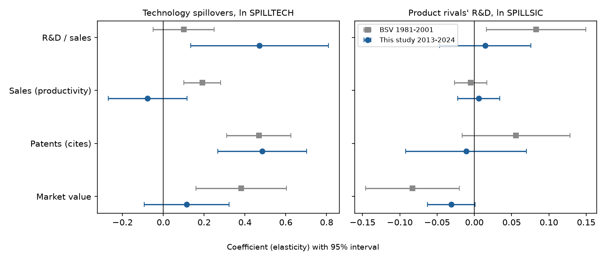
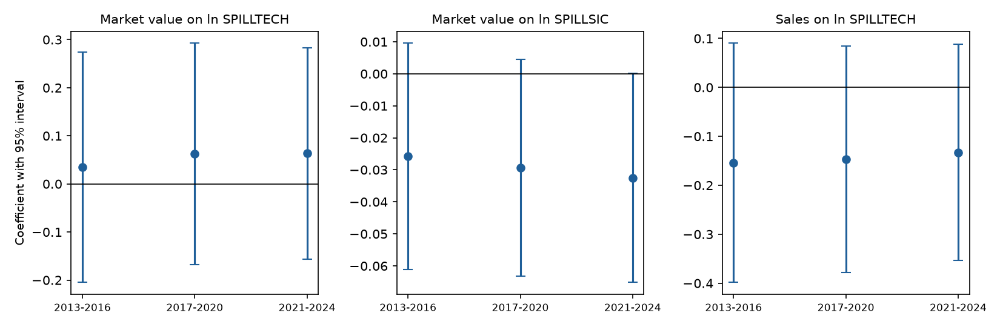

# The Research Next Door

### In 2013 Nicholas Bloom, Mark Schankerman and John Van Reenen measured how much a company gains from its technological neighbors' research and how much it loses to its product-market rivals'. I asked again with 2013–2024 data.

---

The phone in your pocket was built on research that no single company paid for. In 2023 Alphabet reported $45.4
billion of research and development spending to the Securities and Exchange Commission, Meta $38.5 billion, Apple
$29.9 billion and Intel $16.0 billion. Some of what each of them learned stayed private. Much of it leaked, through
patents that others read and design around, engineers who change jobs, papers, standards meetings and reverse
engineering. When Intel works out a better way to lay transistors on silicon, Apple's chip designers benefit
without paying Intel a cent. When a rival phone maker builds a better camera, Apple loses sales.

Those are two different consequences of the same spending, and they push in opposite directions. The first, a
technology spillover, means society gets more out of research than the company that pays for it, which is the
standard argument for R&D tax credits. The second, business stealing, means some research only moves customers from
one firm to another, which is an argument that companies spend too much on it. Which force is bigger decides
whether governments should subsidize corporate research or leave it alone. Bloom, Schankerman and Van Reenen built
the best-known method for separating the two, and I reran it on the last twelve years of American public companies.

---

## Two kinds of neighbor

The method rests on locating every firm twice, once in technology space and once in product-market space. A
firm's position in technology space is the mix of fields its patents fall in. Two firms whose patents land in the
same fields in the same proportions are close, whatever they sell. The closeness measure, due to Adam Jaffe, is
the uncentered correlation of the two firms' patent-share vectors:

```math
\text{TECH}_{ij} = \frac{T_i \, T_j'}{\sqrt{T_i T_i'}\,\sqrt{T_j T_j'}}
```

Here $`T_i`$ is the row of firm $`i`$'s shares of patents across technology classes. I use the Cooperative Patent
Classification at the subclass level (G06F for digital data processing, H01L for semiconductor devices, A61K for
medical preparations) and every patent the firm filed from 2000 to 2022. TECH runs from 0, no overlap at all, to 1,
identical portfolios.

| Pair | TECH, 2000–2022 patents | TECH in the paper, 1970–1999 patents |
|---|---|---|
| IBM and Intel | 0.941 | 0.76 |
| Apple and Intel | 0.899 | 0.47 |
| Motorola Solutions and Intel | 0.596 | 0.46 |
| IBM and Motorola Solutions | 0.420 | 0.46 |

The paper's column is its Appendix Table A1, where the firm was still Motorola before its 2011 split.

Each firm then receives a pool of outside research, the R&D stocks of every other firm weighted by closeness:

```math
\text{SPILLTECH}_{it} = \sum_{j \neq i} \text{TECH}_{ij}\, G_{jt}, \qquad \text{SPILLSIC}_{it} = \sum_{j \neq i} \text{SIC}_{ij}\, G_{jt}
```

$`G_{jt}`$ is firm $`j`$'s stock of accumulated R&D, built as in the paper by adding each year's spending to 85% of
the previous year's stock (a 15% depreciation rate). $`\text{SIC}_{ij}`$ is closeness in product markets. In the
paper it was the correlation of the two firms' sales across four-digit industries; with public data I can only say
whether two firms share a four-digit industry code, so here it is 1 or 0. The technology pool that enters Apple's
2024 equation, built from 2023 stocks, shows the arithmetic:

```math
\underbrace{0.8986}_{\text{TECH}_{\text{Apple, Intel}}} \times \underbrace{\$87.18\text{bn}}_{G_{\text{Intel},2023}} = \$78.34\text{bn},
\quad \frac{78.34}{966.35} = 8.1\%\ \text{of Apple's pool}
```

Intel alone accounts for about a twelfth of the outside research that Apple's patents say it can draw on.

---

## The paper and the people who wrote it

Nicholas Bloom is an economist at Stanford. Mark Schankerman is a professor of economics at the London School of
Economics. John Van Reenen directed the LSE's Centre for Economic Performance when the paper was revised and had
moved to MIT by 2019. Their paper, "Identifying Technology Spillovers and Product Market Rivalry," first circulated
as a discussion paper in February 2005, and the published version appeared in *Econometrica* in July 2013.

The core of the paper is a two-stage model. Firm 0 first chooses R&D $`r_0`$, which produces knowledge
$`k_0 = \phi(r_0, r_\tau)`$, where $`r_\tau`$ is research by a firm close in technology. Firms then compete, and
firm 0 earns $`\Pi(k_0, r_m)`$, where $`r_m`$ is research by a product-market rival. Assume $`\phi`$ rises in both
arguments, $`\Pi`$ rises in own knowledge and does not rise in the rival's research, and firm 0 chooses $`r_0`$
optimally, so that the first-order condition $`\Pi_1 \phi_1 = 1`$ holds. Subscripts denote partial derivatives.
Because of that condition, a change in $`r_0`$ induced by outside research has no first-order effect on value
(the envelope theorem), which leaves only the direct effects:

```math
\begin{aligned}
V_0^* &= \max_{r_0}\; \Pi\big(\phi(r_0, r_\tau),\, r_m\big) - r_0 \\
\frac{d V_0^*}{d r_\tau} &= (\Pi_1 \phi_1 - 1)\frac{\partial r_0^*}{\partial r_\tau} + \Pi_1\, \phi_2 = \Pi_1\, \phi_2 \;\ge\; 0 \\
\frac{d V_0^*}{d r_m} &= (\Pi_1 \phi_1 - 1)\frac{\partial r_0^*}{\partial r_m} + \Pi_2 = \Pi_2 \;\le\; 0 \\
\frac{\partial k_0}{\partial r_m}\Big|_{r_0} &= 0
\end{aligned}
```

A neighbor's research raises a firm's value because it raises the firm's knowledge, a rival's research lowers it,
and for a given level of the firm's own R&D a rival's research should leave the firm's knowledge (its patents and
productivity) unchanged.

Bloom, Schankerman and Van Reenen tested this on 715 Compustat firms from 1981 to 2001. With firm fixed effects,
a 10% rise in the technology pool went with a 3.8% rise in market value, and a 10% rise in rivals' R&D with a 0.8%
fall (coefficients 0.381 and −0.083 in their Table 3). Technology spillovers raised patents and productivity;
rivals' research did not. They then turned the coefficients into returns. With $`\psi_1`$ the output elasticity of
own R&D, $`\psi_2`$ that of the technology pool, $`\gamma_3`$ the market-value elasticity of the rivals' pool and
$`\sigma = 1/2`$ the share of a rival-induced value loss that is lost output, their simplest version is

```math
\text{MSR} = \frac{Y}{G}\,(\psi_1 + \psi_2), \qquad \text{MPR} = \frac{Y}{G}\,(\psi_1 - \sigma\gamma_3)
```

At their median sales-to-R&D-stock ratio of 2.48 this gives a marginal social return of 58% and a private return
of 20.8%; the full calculation in their Table 9 gives 55.0% and 20.7%. Society earns more than twice what the
investing firm does, so by this measure America underinvests in research.

The strongest objection is one the authors raised themselves. Firms that sit near each other in technology space
face the same technological opportunities, so a wave of discoveries in, say, wireless chips will lift every firm
in that field at once, and a regression will read the common wave as one firm's research helping another. The
authors answered with instruments built from federal and state R&D tax credits, which shift a firm's research for
reasons unrelated to its field, and found larger effects. The measures themselves drew a second objection. Peter
Thompson and Melanie Fox-Kean (2005) argued that broad patent classes are too coarse a map of knowledge, and when
the authors rebuilt TECH from finer classes the patent coefficient held at 0.434 but the market-value coefficient
fell to 0.105, with a standard error of 0.062 (their Appendix Table A3). In 2019 Bloom and Van Reenen, with Brian
Lucking, re-estimated the model on data through 2015 and reported a technology coefficient of 0.324, a
rivalry coefficient of −0.086, and a social return of 57.7% against a private return of 13.6%.

---

## How I tested it

I rebuilt the panel from public sources. Accounts come from the SEC's Financial Statement Data Sets, every 10-K
filed from mid-2011 to mid-2026, for revenue, R&D, cost of goods sold, selling and administrative expense,
property and equipment, total assets and total liabilities. Market value is the public float that each 10-K
reports on its cover, the stock-market value of shares held by outsiders, plus total liabilities. Patents come from
the data set of Kogan, Papanikolaou, Seru and Stoffman, which assigns every US patent held by a listed company to
that company, with its citations and technology codes; I matched those companies to SEC filers by the patent
assignee's name.

I kept the paper's rules where I could. Firms must patent (to have a technology position) and report positive R&D
in at least four years; R&D stocks use 15% depreciation; both pools enter with a one-year lag; every equation has
firm and year fixed effects, and the patent equation uses the paper's pre-sample patenting (here 2000–2009) in place
of fixed effects. I added three rules of my own before looking at results. Estimation firms need median sales of
at least $10 million, a public float more than 50 times above or below the firm's own median is treated as a
tagging error, and the top and bottom 0.5% of Tobin's Q are dropped. A fourth rule came later, after an audit of
the patent links found a few filers that had inherited another company's whole portfolio (PTC Therapeutics on three
of Amgen's patents, for one); a filer now needs at least half as many matched patents as the best match for that
company, a change that moved the estimates only slightly. The pools use all 1,887 patenting R&D firms,
which together did 89.5% of the R&D reported on 10-Ks in 2023. The market-value equation, following the paper, is

```math
\begin{aligned}
\ln Q_{it} = {} & \sum_{k=1}^{6} \beta_k \Big(\tfrac{G}{A}\Big)_{i,t-1}^{k} + \gamma_2 \ln \text{SPILLTECH}_{i,t-1} + \gamma_3 \ln \text{SPILLSIC}_{i,t-1} \\
& + \delta' x_{it} + \alpha_i + \tau_t + \varepsilon_{it}, \qquad H_0\!: \gamma_2 = 0,\ \gamma_3 = 0
\end{aligned}
```

where $`Q`$ is market value over total assets, the sixth-order polynomial in lagged R&D stock over lagged assets
(capped at its 99th percentile) approximates the value of the firm's own knowledge, $`x_{it}`$ holds the logs of
current and lagged sales of the other SEC filers in the same four-digit industry, $`\alpha_i`$ and $`\tau_t`$ are
firm and year effects, and standard errors are clustered by firm. The production function replaces $`\ln Q`$ with
log sales and the polynomial with lagged log capital, lagged log variable costs (cost of goods sold plus selling and
administrative expense) and lagged log R&D stock. The patent equation is a negative binomial for citations to the
patents a firm filed that year:

```math
\begin{aligned}
\mathbb{E}[P_{it}] = \exp\big(& \theta_1 \ln G_{i,t-1} + \theta_2 \ln \text{SPILLTECH}_{i,t-1} + \theta_3 \ln \text{SPILLSIC}_{i,t-1} \\
& + \theta_4 \ln Y_{i,t-1} + \lambda \ln \bar{P}_i^{\,2000\text{–}09} + \tau_t + \eta_{s}\big), \qquad H_0\!: \theta_2 = 0
\end{aligned}
```

with $`P_{it}`$ the forward citations to the patents firm $`i`$ filed in year $`t`$ (2013 to 2020),
$`Y_{i,t-1}`$ lagged sales, $`\bar{P}_i^{\,2000\text{–}09}`$ the firm's mean yearly citations to patents filed in
2000 to 2009 (with a dummy for firms that had none), and $`\eta_s`$ two-digit industry effects; standard errors are
again clustered by firm. Two substitutions matter most. The SEC does not publish employment, so my
production function uses costs where the paper used workers, and my product-market measure is a binary shared
industry code rather than a correlation over segments.

---

## Neighbors' research still predicts a firm's patents

The patent equation is where the 2013–2024 data agree most closely with the paper.

| Patent equation, pre-sample fixed effect | Paper, 1981–2001 | This study, 2013–2020 filings |
|---|---|---|
| ln SPILLTECH | 0.468 (0.080) | 0.485 (0.111) |
| ln SPILLSIC | 0.056 (0.037) | −0.011 (0.041) |
| Firm-years | 9,023 | 6,278 |

```math
\hat{\theta}_2 = 0.485\ (0.111),\quad 95\%\ \text{CI}\ [0.267,\ 0.702],\qquad \hat{\theta}_3 = -0.011\ (0.041),\quad N = 6{,}278
```

Holding a firm's own R&D fixed, a 10% larger pool of neighbors' research goes with about 5% more citations to the
firm's new patents, while rivals' research has no detectable effect, which is the pattern the model predicts. With
plain patent counts instead of citations the technology coefficient is 0.270 (0.068), close to the 0.295 the
paper reports for counts. The two pools are about as distinct as they were in the paper. Across all firm pairs
TECH and SIC correlate at 0.505 (the paper reported 0.469), the logged pools at 0.456 (0.422), and within firms
over time at 0.328 (0.319).



---

## Rivals' research still costs a firm value, but less than it did

In the market-value equation the business-stealing coefficient keeps its sign and shrinks. The technology
coefficient loses its precision.

```math
\begin{aligned}
\hat{\gamma}_3 &= -0.031\ (0.016),\quad 95\%\ \text{CI}\ [-0.063,\ 0.001] \\
\hat{\gamma}_2 &= 0.114\ (0.106),\quad N = 9{,}407,\ 1{,}276\ \text{firms}
\end{aligned}
```

A 10% rise in the R&D of firms in the same industry goes with a 0.3% lower market value, against 0.8% in the
paper, with a p-value of 0.058. The technology pool's coefficient, 0.114, is positive but a third of the paper's
and not distinguishable from zero. Without fixed effects the technology coefficient is a precise 0.069 (0.016),
so firms with research-heavy neighbors are valued more in the cross-section; it is the year-to-year changes within
a firm that say little.

The R&D equation also departs from the paper. The original found that firms spend more on research when their
product-market rivals do, a sign of a research race. Here the rivals' coefficient is 0.015 (0.031), and it is the
technology pool that predicts a firm's own research intensity, at 0.471 (0.172).

The table below shows the firms behind these numbers in 2023. Spillover pools are in billions of dollars of
closeness-weighted R&D stock, and same-industry rivals are the other estimation-sample firms with the same
four-digit SIC code.

| Firm | R&D, 2023 | Technology pool | Rivals' pool | Same-industry rivals | Nearest in technology (TECH) |
|---|---|---|---|---|---|
| Alphabet | $45.4bn | $856bn | $108bn | 17 | Microsoft (0.978) |
| Meta Platforms | $38.5bn | $882bn | $159bn | 17 | Alphabet (0.927) |
| Merck | $30.5bn | $436bn | $423bn | 127 | Bristol Myers Squibb (0.976) |
| Apple | $29.9bn | $884bn | $20bn | 4 | Alphabet (0.927) |
| Microsoft | $29.5bn | $871bn | $189bn | 94 | Oracle (0.989) |
| Intel | $16.0bn | $894bn | $143bn | 57 | IBM (0.941) |
| Nvidia | $8.7bn | $811bn | $205bn | 57 | Autodesk (0.971) |
| Tesla | $4.0bn | $304bn | $3.4bn | 2 | Bloom Energy (0.737) |
| Boeing | $3.4bn | $451bn | $0.6bn | 1 | Textron (0.730) |

Apple's patents sit almost on top of Alphabet's, yet the two share no industry code, so Alphabet's research counts
fully toward Apple's technology pool and not at all toward its rivals'. Merck's nearest research neighbor, Bristol
Myers Squibb, is also one of its 127 same-code rivals, and that overlap is what the method was designed to
untangle.

---

## The productivity gain does not appear in twelve years of data

The paper's social return rests on the production function, and there the modern data find nothing.

```math
\hat{\psi}_2 = -0.077\ (0.099),\quad \hat{\psi}_1 = 0.046\ (0.038),\quad N = 8{,}079
```

Plugging these into the return formulas at the median sales-to-R&D-stock ratio of 1.80 gives

```math
\begin{aligned}
\widehat{\text{MSR}} &= 1.800\,(0.0464 - 0.0768) = -5.5\%, & 95\%\ \text{CI}\ [-43.1\%,\ 32.2\%] \\
\widehat{\text{MPR}} &= 1.800\,(0.0464 + 0.5 \times 0.0308) = 11.1\%, & 95\%\ \text{CI}\ [-2.5\%,\ 24.8\%]
\end{aligned}
```

The interval for the social return runs from well below zero to large positive values, though it stops short of
the 55% the paper found, and my production function is not the paper's. The interval is this wide mostly because
the technology pool barely moves inside a firm once the general growth of research is removed. Its within-firm
standard deviation net of year effects is 0.13 log points, against 0.32 for the rivals' pool and 0.34 for Tobin's
Q. TECH is fixed for each pair of firms, as in the paper, so a firm's pool moves only when its neighbors' research
grows faster or slower than everyone else's, and over twelve years that happens too little for the fixed-effects
design to work with. The paper's panel ran twenty years, from 1981 to 2001. The cross-section points the paper's
way, with a production coefficient of 0.120 (0.017) on the technology pool and −0.046 (0.011) on rivals' research,
but a cross-section cannot separate a spillover from the common opportunities that draw firms into the same
fields.

Building the pools only from the 528 firms with an R&D stock in every year from 2012 to 2024, so that companies
entering and leaving the SEC data cannot move anyone's pool, does not rescue the result. The market-value
technology coefficient becomes 0.188 (0.166) and the production coefficient −0.238 (0.137).

---

## The estimates did not drift between 2013 and 2024

Lucking, Bloom and Van Reenen found that spillover coefficients in the early 2010s matched those of the 1980s, after
a rise during the late-1990s technology boom. I carried their exercise forward by letting the market-value and
production coefficients differ across three four-year blocks.

| Block | Value on ln SPILLTECH | Value on ln SPILLSIC | Sales on ln SPILLTECH |
|---|---|---|---|
| 2013–2016 | 0.035 (0.122) | −0.026 (0.018) | −0.154 (0.125) |
| 2017–2020 | 0.063 (0.117) | −0.029 (0.017) | −0.147 (0.118) |
| 2021–2024 | 0.064 (0.112) | −0.033 (0.017) | −0.133 (0.113) |

Wald tests of equal coefficients across blocks give p-values of 0.27 for the technology pool in market value, 0.78
for the rivals' pool, and 0.60 for the technology pool in production. The business-stealing coefficient edges
more negative and comes closest to significance in the last block (p = 0.050), but the data cannot tell the blocks
apart. Every block estimate of a technology coefficient lies below the pooled one (0.114 in market value, −0.077 in
production). Splitting a pool by period changes the variation each coefficient uses, since a split pool also jumps
when a firm passes from one block to the next, so the block estimates are comparable with each other and not with
the pooled figures.



---

## Why it matters

For consumers, the patent result is the encouraging part. Research by one company still feeds the inventions of
its technological neighbors, and the products that come from those inventions reach people who never paid for the
original work.

For workers, the scientists and engineers who carry ideas between firms are much of the channel. A technology pool
that predicts patenting even after controlling for a firm's own spending is consistent with knowledge moving with
people and publications, which is one argument for keeping it easy to change employers.

For smaller firms, the paper found that small companies generate smaller spillovers because they work in
technological niches, which led the authors to question the higher R&D tax-credit rates that policymakers give small
firms. I did not re-test that split; the fixed-effects estimates here are too imprecise to divide by size.

For policy, the case for R&D tax credits leans on the social return exceeding the private one. Public 2013–2024
data agree with the paper on the technology-to-patent channel and on the sign of business stealing, but they cannot
pin down the social return, and this rerun is not a reason to revise the credit in either direction.

---

## Limits of this study

The SEC data cover listed companies only, the product-market measure is a single industry code per firm (so IBM
and Apple, the paper's own example of direct competitors, count as unrelated because one is coded 3570 and the
other 3571), and public float leaves out shares held by insiders, a large stake at some founder-led firms. Amazon reports
technology and content spending rather than R&D and drops out; Ford and General Motors report no R&D figure among
the tagged values this study reads, so they drop out too. The production function uses costs instead of employment,
so it measures productivity conditional on variable inputs, which can absorb part of a spillover. Patent technology
classes are coarser than the knowledge they stand for. And nothing here is instrumented, so even the clean patent result shows
association, not the causal effect the paper's tax-credit instruments were built to find.

---

## Further reading

- [TECHNICAL.md](TECHNICAL.md) has the data, rules, every test statistic and how to reproduce the results.
- [results/FINDINGS.md](results/FINDINGS.md) collects every table the scripts produce.
- [METHODS_REVIEW.md](METHODS_REVIEW.md) is a methods and statistical-reporting review of the original paper.
- Bloom, N., Schankerman, M. and Van Reenen, J. (2013), "Identifying Technology Spillovers and Product Market
  Rivalry," *Econometrica* 81(4), 1347–1393. The free CEP Discussion Paper No. 675 version is at
  cep.lse.ac.uk.
- Thompson, P. and Fox-Kean, M. (2005), "Patent Citations and the Geography of Knowledge Spillovers: A
  Reassessment," *American Economic Review* 95(1), 450–461.
- Lucking, B., Bloom, N. and Van Reenen, J. (2019), "Have R&D Spillovers Declined in the 21st Century?" *Fiscal
  Studies* 40(4), 561–590.
- SEC Financial Statement Data Sets, sec.gov/dera/data/financial-statement-data-sets.
- SEC XBRL company facts (the EntityPublicFloat tag for public float), read through the edgar_xbrl_companyfacts mirror on
  Hugging Face.
- Kogan, Papanikolaou, Seru and Stoffman patent data, extended to 2025, github.com/KPSS2017.
- USPTO PatentsView, disambiguated assignees, release of December 31, 2024.

*Brendyn Beasley*
